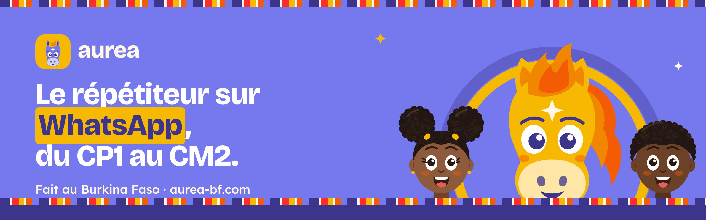
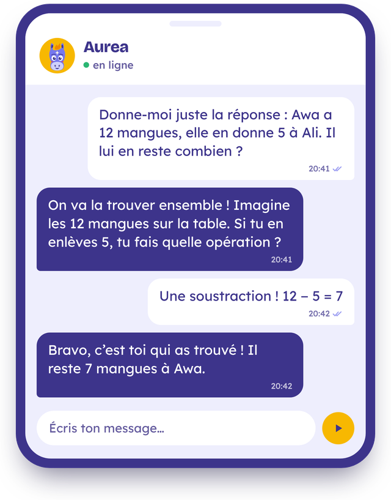

## Chaque soir, un répétiteur patient à côté de votre enfant

**Aurea aide les élèves du primaire, du CP1 au CM2, à faire leurs devoirs et à réviser leurs leçons, directement sur WhatsApp.**

L'enfant écrit sa question : une leçon à revoir, un exercice qui bloque. Aurea ne donne pas la réponse toute faite. Comme un bon répétiteur, Aurea pose les bonnes questions, explique avec des exemples d'ici (le marché, les mangues, le chemin de l'école) et laisse l'enfant trouver lui-même.

Aurea ne remplace pas l'enseignant : le service prolonge la classe à la maison.

## Comment ça marche

**1. L'enfant écrit sur WhatsApp** 
Une leçon, un exercice, une difficulté du jour. Selon la formule, il peut aussi envoyer un message vocal ou la photo de son devoir.

**2. Aurea comprend le besoin** 
Une explication, un exercice guidé, une question pour réfléchir ou un encouragement.

**3. L'enfant avance à son rythme** 
Le vocabulaire et le niveau suivent sa classe. C'est l'enfant qui trouve la réponse.

**Et chaque soir**, un petit rappel à l'heure choisie par le parent : 15 minutes suffisent.

## Nos engagements

- **Guider, jamais tricher.** L'enfant comprend, puis trouve la réponse lui-même.
- **Le programme officiel, du CP1 au CM2.** Les explications suivent la classe de l'enfant.
- **Des exemples d'ici.** Des prénoms, des plats et des lieux que l'enfant connaît.
- **Un téléphone suffit.** Même partagé en famille, avec peu de données et rien à installer.
- **Aux côtés des enseignants,** jamais à leur place.
- **La vie privée des enfants.** Jamais de photo ni de vidéo d'un enfant sans l'accord écrit de ses parents, et jamais le nom de son école.

<!-- SÉCURITÉ ET DONNÉES : à compléter, puis retirer les deux marques de commentaire (la ligne du début et celle de la fin)
## Sécurité et données
- Qui peut lire les conversations : ...
- Où sont gardées les données, et combien de temps : ...
- Comment un parent peut tout effacer : ...
-->

## Tarifs

Dès **1 500 FCFA par mois** et par élève, payés par Orange Money ou Moov Money. **La première semaine est offerte.** Toutes les formules sur [aurea-bf.com](https://aurea-bf.com).

## Roro, notre mascotte

Roro est un étalon d'or, en clin d'œil à l'étalon de la princesse Yennenga. Son pelage d'or rappelle le nom Aurea, sa crinière forme un soleil levant, et l'étoile sur son front est celle de l'élève qui comprend.

## Travaillons ensemble

Écoles, associations de parents d'élèves, ONG, entreprises : pour offrir Aurea à des élèves ou monter un projet avec nous, écrivez-nous depuis [aurea-bf.com](https://aurea-bf.com).

<!-- CONTACTS : à compléter, puis retirer les deux marques de commentaire
- WhatsApp : [+226 XX XX XX XX](https://wa.me/226XXXXXXXX)
- E-mail : [contact@aurea-bf.com](mailto:contact@aurea-bf.com)
- Facebook : [Aurea Burkina](https://www.facebook.com/...)
-->

<!-- ÉQUIPE : à compléter, puis retirer les deux marques de commentaire
## L'équipe
L'aventure Aurea commence à [ville] en [année]. [Prénom Nom], [rôle] · [Prénom Nom], [rôle].
-->

<b>About Aurea (in English)</b>

**Aurea** is a homework tutor on WhatsApp for primary-school pupils in Burkina Faso, from CP1 to CM2 (grades 1 to 6). The child sends a question; Aurea never hands out the answer, but guides the child step by step, at their grade level, with examples from everyday life. Any phone with WhatsApp works, even a shared family phone, with no app to install. Plans start at 1,500 FCFA per pupil per month, paid with Orange Money or Moov Money, and the first week is free. Aurea supports teachers; it does not replace them. Built in Burkina Faso, by Burkinabè.

Website: [aurea-bf.com](https://aurea-bf.com)

<b>Aurea Burkina</b> · Fait au Burkina Faso, par des Burkinabè · <a href="https://aurea-bf.com">aurea-bf.com</a>

